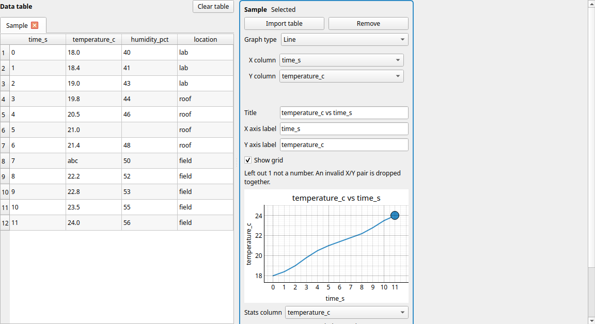
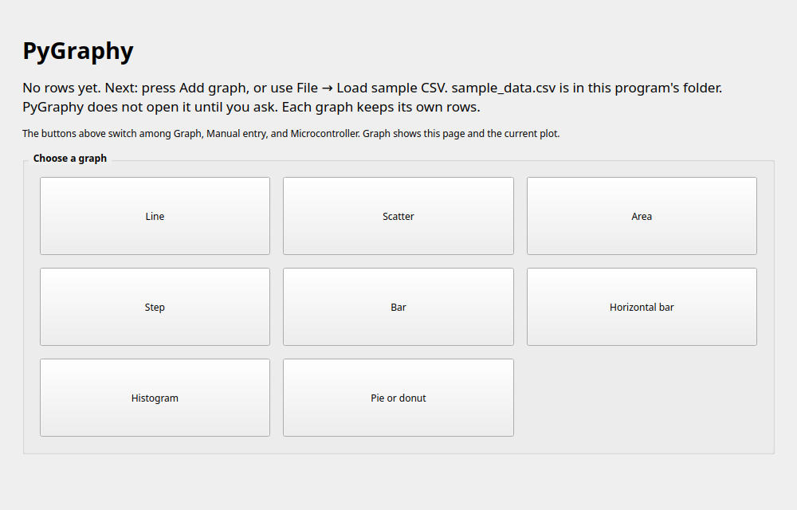
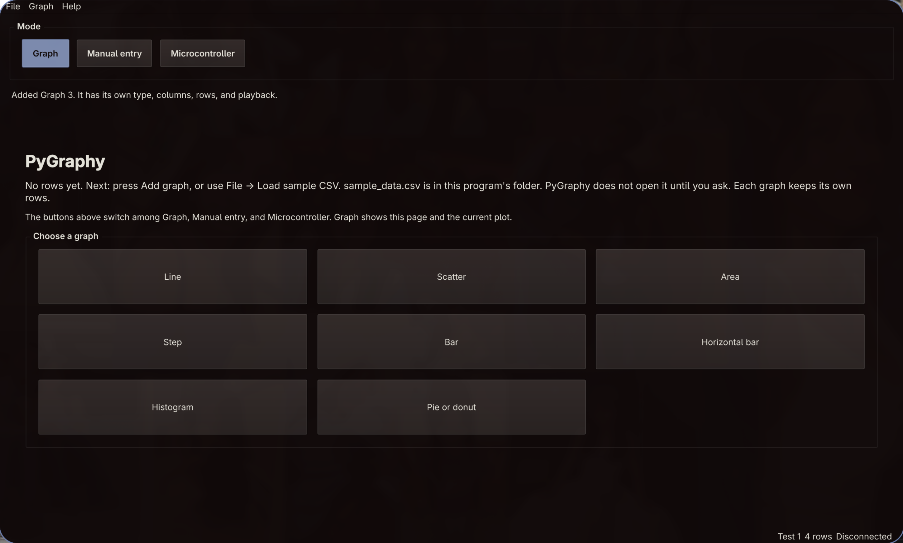
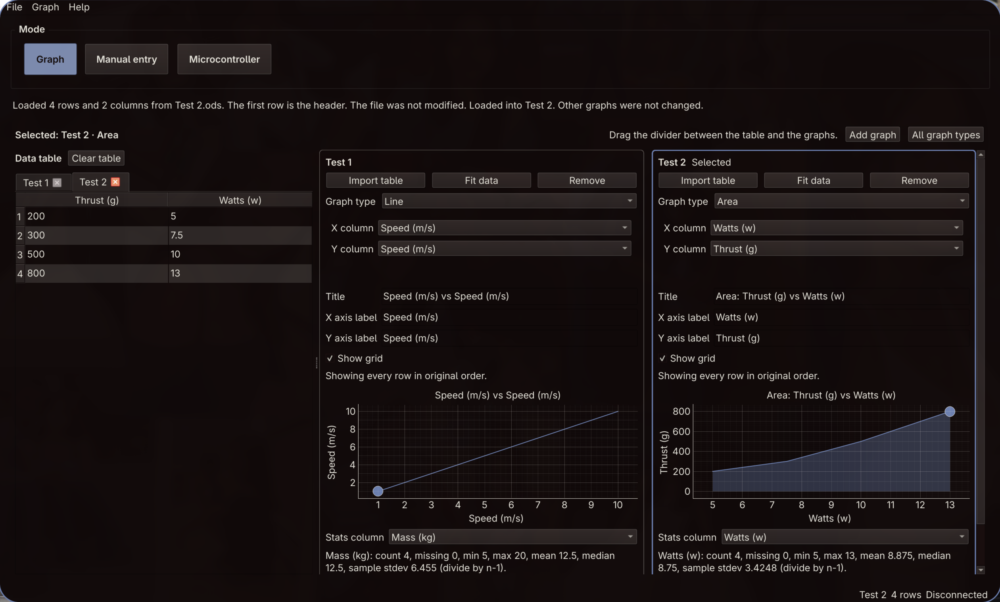
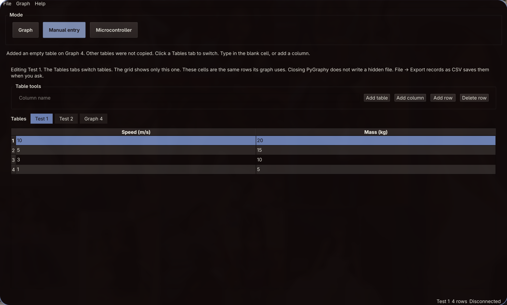
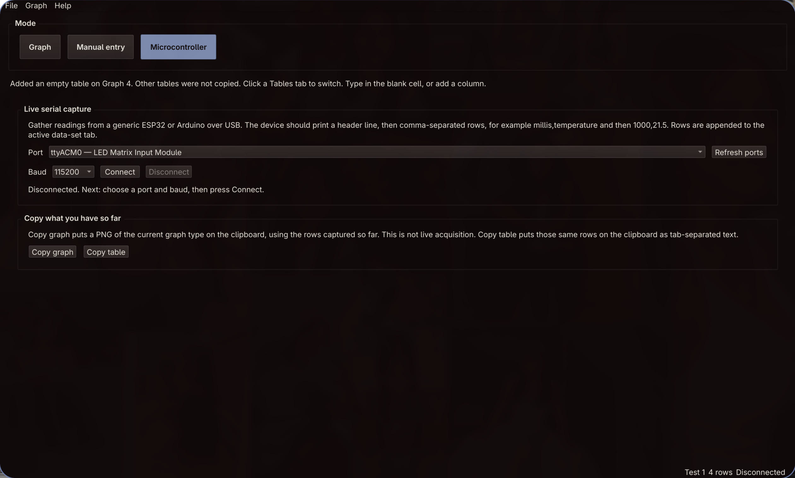
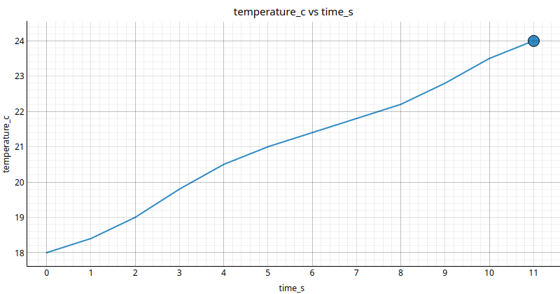
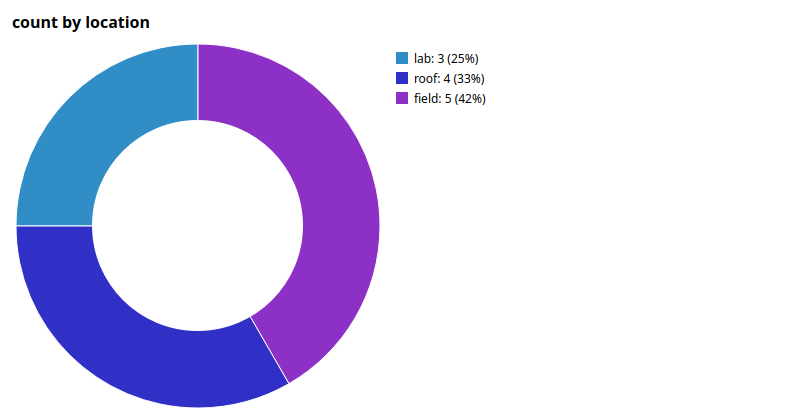

# PyGraphy

A PyQt6 graphing application. It plots one series on each graph from a table you load, type, or capture over USB serial.

The window is the whole program. There is no account, no cloud upload, and no hidden session file. Closing it drops whatever is still only in memory. A CSV you opened is never written back.

It is aimed at someone who wants to plot a table, and at someone who wants to read the code and change it. The longer notes in [docs/](docs/) follow the same files the window uses.



## What the window does

Three mode buttons sit at the top. They change the page. They do not delete rows.

- **Graph** shows the comparison board, or the All graph types page.
- **Manual entry** edits the cells of one table. The Tables tabs switch which table the grid shows.
- **Microcontroller** holds Live serial capture, plus Copy graph and Copy table.

Every launch opens with no graphs and no rows. The status bar says "No data set" and "0 rows". The sample file stays closed until you choose File → Load sample CSV. **Clear table** sits on the data table, above the grid. It clears the selected graph in memory and does not change the file on disk.

**Add graph** puts another graph beside the others. Each one keeps its own rows, its own type, its own columns, and its own record-playback timer. One series is all a single graph draws. A second graph is how you show a second series. **Fit data** on a graph zooms it to the rows that graph holds.

**Add table** on Manual entry starts a blank table without leaving the page. It does not copy another table's rows. The **Tables** tabs switch which table the grid shows, and each table keeps its own cells.

The graph types are Line, Scatter, Area, Step, Bar, Horizontal bar, Histogram, and Pie or donut.



Line, scatter, area, step, bar, horizontal bar, and histogram use PyQtGraph. The pie is a donut drawn with `QPainter`, because `PyQt6.QtCharts` is not installed. Box plots and candlesticks are not included. PyQtGraph does not draw those from one line or one bar item.

On Omarchy, the window uses the active theme's background, text, and accent, and it updates when that theme file changes. On other Linux desktops it follows the freedesktop light or dark setting. On Windows and macOS the same light or dark switch is followed, and the default dark colors are a warm brown and periwinkle set that matches the Linux look.

File, Graph, and Help are the menus. The status bar shows the data-set name, the row count, and whether USB serial is connected.

## Screenshots









## Requirements

- Python 3.10 or newer.
- The packages pinned in `requirements.txt` (PyQt6, PyQtGraph, openpyxl, odfpy, and the libraries those packages need).
- A graphical desktop. No microcontroller is required. The sample file is enough to try every graph type.

This folder does not contain a Windows `.exe` installer or a Mac `.app`. Those packages have to be built on Windows and on a Mac.

## Install

The blocks below were run on Linux. The macOS commands are the same, because a virtual environment there also uses `.venv/bin`. The Windows commands are the same steps with the `py` launcher and `Scripts`.

`pip install .` creates a `pygraphy` command inside the virtual environment. That command belongs to that copy of Python. It is not one program file that runs on Linux, macOS, and Windows.

### Linux and macOS

From the project folder:

```bash
python3 -m venv .venv
.venv/bin/python -m pip install -r requirements.txt
.venv/bin/python -m pip install .
.venv/bin/pygraphy
```

`requirements.txt` pins the versions. `pip install .` adds the `pygraphy` command and copies `sample_data.csv` and `style.qss` into the virtual environment. You can skip `pip install .` and start with `.venv/bin/python main.py` instead.

If `python3 -m venv` says that ensurepip is not available, install the distro package that provides the venv module (on Debian and Ubuntu, `python3-venv`), delete the incomplete `.venv` folder, and run the command again.

### Windows

Use the `py` launcher in Command Prompt or PowerShell, from the project folder:

```bat
py -m venv .venv
.\.venv\Scripts\python.exe -m pip install -r requirements.txt
.\.venv\Scripts\python.exe -m pip install .
.\.venv\Scripts\pygraphy.exe
```

`.\.venv\Scripts\python.exe main.py` from the project folder still works.

### How to start it after install

Linux: `pygraphy.desktop` is a template. It starts the `pygraphy` command from `PATH` and does not name a home directory. After the install above, put the virtual environment's `bin` directory on `PATH`, or copy the file to `~/.local/share/applications/pygraphy.desktop` and set `Exec` to that computer's `.venv/bin/pygraphy` (and `Path` to the project folder, for example `~/PyGraphy`).

Windows: start PyGraphy by running `.\.venv\Scripts\pygraphy.exe` from the project folder. You can pin that program. A frozen Windows `.exe` is not built here. Build that package on Windows if you want one.

macOS: start PyGraphy from Terminal with `.venv/bin/pygraphy` after the install commands above. A Mac `.app` is not built here. Build that package on a Mac if you want one.

## Run

```bash
.venv/bin/pygraphy
```

Or, without the installed command:

```bash
.venv/bin/python main.py
```

The sample CSV does not open by itself.

## Walkthrough

1. **Start empty.** Launch the app. The graph area says no graphs yet. The table has no rows. The status bar says "No data set", "0 rows", and "Disconnected". The menus are File, Graph, and Help.

2. **Load the sample.** Choose File → Load sample CSV. PyGraphy adds a graph, names the tab Sample, and reads `sample_data.csv` from the program folder. The notice names that file and says it was not modified. The status bar shows 12 rows. The line is `temperature_c` against `time_s`.

   

3. **Resize the panes.** Drag the divider between the table and the graphs. Both panes stay visible.

4. **See what was left out.** The table still shows `abc` in `temperature_c`, and a blank humidity cell. The graph note says that row was left out. A line or scatter drops the whole row when either side is not a number. The text stays in the table.

5. **Sort the table.** Click the `temperature_c` header. The rows on screen move. The line does not. `RowOrderProxy` sorts the view. `DataSet.rows` stays in file order, and that is the order the plot and playback use. The row numbers in the vertical header are the original ones.

6. **Switch type.** Use the Graph type box on the selected graph, the Graph menu, or All graph types. Scatter, Area, and Step use the same X and Y columns. Bar and Horizontal bar group by a category (count, sum, or mean). Histogram needs a numeric column and a bin count. Pie or donut uses a category.

   On the sample, Bar with category `location` and mean of `temperature_c` has one bar for lab, roof, and field. Pie or donut with Values set to count draws lab 3, roof 4, field 5.

   

7. **Fit the graph to its own rows.** Press Fit data on the graph. Each graph zooms to the rows it holds, so two graphs with different amounts of data both fill their panel. Playback keeps that full-data range instead of zooming on every frame.

8. **Read the stats.** The stats line is for one numeric column of the whole data set, not only the rows playback is showing. For `temperature_c` the count is 11, because `abc` is missing. Sample standard deviation divides by n−1. With fewer than two numbers the line shows an em dash.

9. **Play the recording.** Under the graph, press Reset, then Play, then Pause. The marker glides along the original rows. Change the speed (0.5x, 1x, 2x, 4x). "Reveal the line" draws the series as it advances. "Marker on the full line" keeps the whole series on screen and moves the marker. This timer is not the serial port. Each graph has its own timer. Loading a new table, or switching away from that graph's rows, stops it.

10. **Add a second graph.** Press Add graph. The new graph starts empty and is marked Selected. File → Load sample CSV, Open CSV, Import table, and Paste table go into the selected graph. If that graph already has rows, PyGraphy asks before replacing them. Clear table asks, then forgets that graph's rows and columns in memory. The other graphs stay as they are. The file on disk is not modified.

11. **Type a table.** Press Manual entry. Press Add table to start a blank table. It does not copy another table's rows. Type a column name and press Add column, then press Add row, then type in the cells. The Tables tabs switch which table the grid shows, and each table keeps its own cells. The characters stay text until a graph parses them. These are the same rows that table's graph uses. Closing PyGraphy does not write them. File → Export records as CSV saves them when you ask.

12. **Import or paste.** File → Open CSV reads a `.csv` file. File → Import table also reads `.xlsx` (Excel, or a Google Sheets file saved as xlsx) and `.ods` (LibreOffice Calc). There is no Google login. The workbook is opened for reading and closed. File → Paste table reads tab-separated cells from the clipboard. The first row is the header.

13. **Serial, without a board if you do not have one.** Press Microcontroller. The panel is labeled Live serial capture. Refresh ports, leave the baud at 115200 unless your board uses another rate, then Connect. The device should print a header line, then comma-separated rows, for example `millis,temperature` and then `1000,21.5`. Rows are appended to the selected data set. Copy graph puts a PNG of the current graph on the clipboard, using the rows captured so far. Copy table puts those rows on the clipboard as tab-separated text, in original order. Neither button is live acquisition.

14. **Export.** File → Export graph as PNG saves the selected graph. File → Export records as CSV writes the selected rows in original order. Export refuses the file you loaded. Any other existing file asks "Replace it?" first.

15. **About.** Help → About PyGraphy restates the same limits: one series per graph, no session file, donut drawn with `QPainter`.

## Sample file

`sample_data.csv` sits next to the Python files. Startup leaves it closed on purpose. `sample_csv_path()` in `dataset.py` finds it from the program, not from the shell's current directory. File → Load sample CSV opens it. Clear table forgets the open tab in memory and does not change this file.

The columns are `time_s`, `temperature_c`, `humidity_pct`, and `location`. Twelve data rows. One humidity cell is blank. One temperature cell is `abc`. Those two are there so every graph type has something to show or leave out. Locations are lab (3), roof (4), and field (5).

## Live serial

The panel is separate from Record playback. The baud choices are 9600, 19200, 38400, 57600, 115200, and 230400. The box starts at 115200. Connect opens your serial port for read and write and releases DTR so a typical board can leave reset.

The first complete line is the column header. Later lines are comma-separated values. They are stored as text, same as a CSV. If the header does not match the selected data set, PyGraphy sets a hold and skips following rows instead of mixing two shapes of data. Switching graphs, or Disconnect, clears that hold.

Bytes are read when Qt emits `readyRead`. The slot copies what is already waiting and returns. It does not sleep, so the window can still repaint and Play still responds.

This copy has not been tested by opening a connected board. The panel lists whatever ports the computer exposes. Pick your serial port. Leave a port alone unless the board is yours.

## Themes

`style.qss` is the only styling file. It uses `palette()` roles, not a fixed hex color, so a light or dark change can restyle the window. Edit a font or a spacing there, then start the app again. A theme change while the app is open is picked up by `appearance.py`, which reads `style.qss` again.

Linux keeps the desktop style. Omarchy reads `colors.toml` from the active theme folder (`XDG_STATE_HOME` or `~/.local/state`, then `omarchy/current/theme`) and applies it again when that file changes. Other Linux desktops follow the freedesktop color-scheme setting. The palette saved at startup is restored when the scheme returns to the one the computer used then. The other side comes from the widget style.

Windows and macOS do not inherit that Linux theme, and their native styles ignore most palette roles. PyGraphy uses the Fusion style there so buttons, fields, tables, tabs, and plots paint from the palette. When the system is dark, or has no preference, the palette is a warm dark set that matches the Linux look: near-black brown `#1a1212`, lighter brown panels (`#2a2222` to `#3a3030`), near-white text, and periwinkle `#7b8fc9` for the selected mode button, the selected tab, the highlighted table row, and the plot line, fill, and markers. A light system setting uses a warm light palette with the same accent. Changing the OS appearance while the app is open applies that palette again.

`style.qss` is the same file on every platform. Fusion paints those controls from the palette roles on its own, so Windows and macOS need no extra rules there, and the Linux window is not changed by them.

## Troubleshooting

**`python3 -m venv` says ensurepip is not available.** Install the distro's venv package (on Debian and Ubuntu, `python3-venv`). Remove the incomplete `.venv` directory and create it again.

**`ModuleNotFoundError: No module named 'PyQt6'`.** The packages are in the virtual environment. Start the app with `.venv/bin/python main.py` or `.venv/bin/pygraphy`, not with a different `python` on `PATH`.

**`pygraphy: command not found`.** The command is inside the virtual environment. From the project folder run `.venv/bin/pygraphy`. On Windows run `.\.venv\Scripts\pygraphy.exe`. Putting the environment's `bin` (or `Scripts`) directory on `PATH` is the other way.

**Could not find the sample file.** `sample_csv_path()` looks next to `dataset.py`, then in the virtual environment's `share/pygraphy` folder. Keep `sample_data.csv` with the source, or run `pip install .` again so the installed copy is refreshed.

**The plot skipped a row, or the note starts with "Left out".** Blank cells, the words `na`, `n/a`, `null`, `none`, and `nan`, and any other non-numeric text stay in the table. They are not plotted. For a line or scatter, one bad side of a pair drops both X and Y.

**The pie says the total is 0, or that it cannot show a negative total.** `pie_values` refuses both. A bar chart can show negatives. A column of zeros has no slice.

**No serial ports found.** Plug in a board, then press Refresh ports. The names in the list are the ports on that computer. This copy has not been tested by opening a connected board.

**Connect fails with a permission error.** The message adds a dialout-group hint. Log out and back in after that change. That hint has not been proven against a real port in this copy.

**Rows from the board are skipped.** The header line did not match the open data set. The notice says so. Disconnect, or capture into an empty graph so the header can name the columns.

**Export will not write the file.** Records export refuses the CSV you loaded. Choose a different name. If the file exists, Cancel on "Replace it?" leaves it alone.

**Qt says it could not load the `xcb` platform plugin (Linux).** Install the package that provides `libxcb-cursor`. On Debian and Ubuntu that package is `libxcb-cursor0`. Start PyGraphy again.

**Typed rows are gone after a restart.** Closing the window does not write a session file. Use File → Export records as CSV, or Copy table, before you quit.

## Project structure

| File | What it is |
| --- | --- |
| `main.py` | Entry point. Menus, the three modes, data-set tabs, the read-only table, and the wires between the other modules. |
| `appearance.py` | Omarchy palette, Linux light/dark, the Windows and macOS built-in palette, and loading `style.qss`. |
| `dataset.py` | In-memory rows, CSV / xlsx / ods / paste reading, numeric parsing, aggregations, and statistics. |
| `graph_view.py` | `GRAPH_KINDS`, one `GraphPanel` per graph, the donut, record playback, and the `GraphBoard` that lays panels out. |
| `serial_panel.py` | Live USB serial capture with `QSerialPort`. Not playback. |
| `style.qss` | Fonts, spacing, and which palette role paints which widget. |
| `sample_data.csv` | Bundled rows so every graph type works with no board attached. |
| `pygraphy.desktop` | Linux launcher template. It does not name a home directory. |
| `pyproject.toml` | Package metadata and the `pygraphy` command (`main:main`). |
| `requirements.txt` | Pinned PyQt6, PyQtGraph, openpyxl, odfpy, and their dependencies. |
| `docs/` | A code map, learning notes, a requirements checklist, and a short demo script. |

`DataSet.rows` stays in file order or arrival order. The graph table can sort, and that sort is only a view. Plots, stats, export, and playback read `rows`.

## More documentation

- [docs/code_map.md](docs/code_map.md) — files, functions, and where to edit
- [docs/learning_notes.md](docs/learning_notes.md) — signals, the event loop, sorting, and n−1
- [docs/requirements_checklist.md](docs/requirements_checklist.md) — assignment items and what is unfinished
- [docs/presentation_guide.md](docs/presentation_guide.md) — a five-minute demo script
