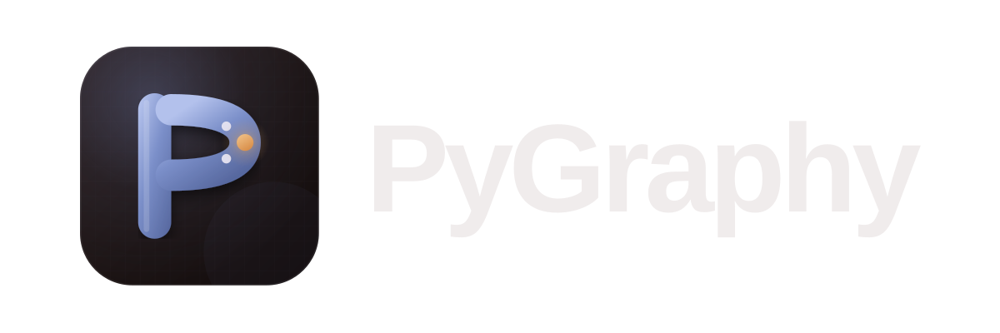

# PyGraphy logo kit

The official mark for **PyGraphy**: a periwinkle **P** whose bowl is a plotted
curve, with one amber data point. It is built from the app's own warm-dark
palette, so the icon, the window, and the docs agree.

## What to send Cursor

Send the whole folder, or just these two files:

1. `assets/logo/pygraphy-icon.svg` — the master artwork, 1024 × 1024, scalable.
2. `CURSOR_PROMPT.md` — exact instructions for wiring it into the repo.

If Cursor can only take one image, give it `assets/logo/pygraphy-icon-1024.png`.
If it needs the wordmark, give it `assets/logo/pygraphy-lockup-dark.svg`.

## Files

| File | Use |
| --- | --- |
| `assets/logo/pygraphy-icon.svg` | Master app icon. Use this everywhere. |
| `assets/logo/pygraphy-icon-small.svg` | Simplified 16–48 px version (no grid). |
| `assets/logo/pygraphy-icon-light.svg` | App icon for light surfaces. |
| `assets/logo/pygraphy-lockup-dark.svg` | Icon + wordmark for dark backgrounds. |
| `assets/logo/pygraphy-lockup-light.svg` | Icon + wordmark for light backgrounds. |
| `assets/logo/pygraphy-mark-mono-dark.svg` | One-colour mark for print, stamps, engraving. |
| `assets/logo/pygraphy-mark-mono-light.svg` | One-colour mark for dark print stock. |
| `assets/logo/pygraphy-icon-1024.png` | Raster app icon, 1024 px, transparent corners. |
| `assets/logo/pygraphy-icon-256.png` | Raster app icon, 256 px, transparent corners. |
| `assets/logo/pygraphy-icon-128.png` | Raster app icon, 128 px, transparent corners. |
| `assets/logo/pygraphy.ico` | Windows icon, 16–256 px in one file. |

## Colour

| Token | Hex | Role |
| --- | --- | --- |
| Warm black | `#1A1212` | Icon background, dark text |
| Surface | `#2A2222` | Raised UI surface |
| Periwinkle | `#7B8FC9` | Primary brand colour, the P |
| Periwinkle light | `#B3C1EC` | Highlight on the P |
| Periwinkle deep | `#57689F` | Shade on the P |
| Amber | `#D98F4A` | The data point — used once, never for large areas |
| Warm white | `#F0ECEC` | Text on dark |
| Warm paper | `#F4F0EC` | Light background |

The amber is an accent, not a second brand colour. One dot per layout.

## Rules

- **Clear space:** keep at least ¼ of the icon width free on every side.
- **Minimum size:** 24 px on screen, 12 mm in print. Below 48 px use
  `pygraphy-icon-small.svg`, not the detailed master.
- **Do not** stretch, rotate, recolour, add shadows, or place the dark icon on
  a busy photo. Use the light icon on light surfaces.
- **Do not** redraw the P, remove the data point, or set the wordmark in another
  typeface. The wordmark is outlined, so it needs no font installed.
- The icon is a rounded square. Keep the corners; do not crop it to a circle.

## Wordmark

"PyGraphy" is set in a bold grotesque, tightly tracked (≈ −4%), with the P and G
capitalised. The supplied lockups are outlined and portable. On the web, use
the dark lockup on dark themes and the light lockup on light themes.

## Preview

